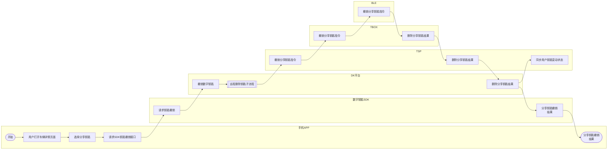
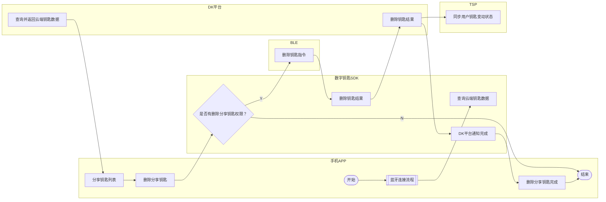

# 10_分享钥匙撤销

> 由 `10_分享钥匙撤销.pos` 转换而来 · ProcessOn Schema File 1.0
> 导出时间：2026-10-22 17:26:45 · 原始标题：未命名文件
> 节点 30 个 · 连线 29 条 · 泳道 6 条

## 概览

- 泳池：分享钥匙撤销
- 流程分组（从上到下）：
  - 远程撤销分享钥匙（y 122–814，16 个节点）
  - 蓝牙撤销分享钥匙（y 816–1521，14 个节点）

### 泳道

| # | 泳道 | x 范围 | 节点数 |
|---|---|---|---|
| 1 | 手机APP | 167–588 | 11 |
| 2 | 数字钥匙SDK | 588–838 | 6 |
| 3 | DK平台 | 838–1088 | 5 |
| 4 | TSP | 1088–1338 | 4 |
| 5 | TBOX | 1338–1584 | 2 |
| 6 | BLE | 1584–1830 | 2 |

## 节点

| # | ID | 分组 | 泳道 | 类型 | 文本 | x | y | 宽 | 高 |
|---|---|---|---|---|---|---|---|---|---|
| 1 | `jNSlrlTyEZ186356` | 远程撤销分享钥匙 | 手机APP | 处理 | 用户打开车辆详情页面 | 403.2 | 173.5 | 100 | 70 |
| 2 | `AABFCYXKMJ764357` | 远程撤销分享钥匙 | 手机APP | 开始/结束 | 开始 | 240.2 | 183.5 | 100 | 50 |
| 3 | `dlHttdZbkP929667` | 远程撤销分享钥匙 | 手机APP | 处理 | 选择分享钥匙 | 403.2 | 274.7 | 100 | 70 |
| 4 | `TXmfCyDEmz486634` | 远程撤销分享钥匙 | 手机APP | 处理 | 请求SDK钥匙撤销接口 | 403.2 | 375.8 | 100 | 70 |
| 5 | `RcehtiyvWa684588` | 远程撤销分享钥匙 | 数字钥匙SDK | 处理 | 请求钥匙撤销 | 661.8 | 375.8 | 100 | 70 |
| 6 | `zoHqSpuwlU881574` | 远程撤销分享钥匙 | DK平台 | 处理 | 撤销数字钥匙 | 909.8 | 375.8 | 100 | 70 |
| 7 | `zGKnLQBviE787186` | 远程撤销分享钥匙 | DK平台 | 子流程 | 远程删除钥匙子流程 | 909.8 | 483.0 | 100 | 70 |
| 8 | `zagqtvbGyC478002` | 远程撤销分享钥匙 | TSP | 处理 | 撤销分享钥匙指令 | 1162.9 | 483.0 | 100 | 70 |
| 9 | `zIngldhdFO702297` | 远程撤销分享钥匙 | TBOX | 处理 | 撤销分享钥匙指令 | 1416.9 | 483.0 | 100 | 70 |
| 10 | `xrQcFsTWNA277224` | 远程撤销分享钥匙 | BLE | 处理 | 撤销分享钥匙指令 | 1670.8 | 483.0 | 100 | 70 |
| 11 | `caTUMpJtjx785558` | 远程撤销分享钥匙 | 数字钥匙SDK | 处理 | 分享钥匙撤销 结果 | 656.0 | 590.1 | 111.5 | 70 |
| 12 | `UjkhPeHGuN118148` | 远程撤销分享钥匙 | DK平台 | 处理 | 删除分享钥匙结果 | 909.8 | 590.1 | 100 | 70 |
| 13 | `tGgwknHTUJ646642` | 远程撤销分享钥匙 | TSP | 处理 | 删除分享钥匙结果 | 1162.9 | 590.1 | 100 | 70 |
| 14 | `CvZnHICpDn686719` | 远程撤销分享钥匙 | TBOX | 处理 | 删除分享钥匙结果 | 1416.9 | 590.1 | 100 | 70 |
| 15 | `WVvJiIPWjA632767` | 远程撤销分享钥匙 | 手机APP | 开始/结束 | 分享钥匙撤销 结果 | 403.2 | 600.1 | 100 | 50 |
| 16 | `aNpvYLsSZE453358` | 远程撤销分享钥匙 | TSP | 处理 | 同步用户钥匙变动状态 | 1162.9 | 697.3 | 100 | 70 |
| 17 | `YIXriVGyXB391230` | 蓝牙撤销分享钥匙 | 手机APP | 子流程 | 蓝牙连接流程 | 403.2 | 854.6 | 100 | 70 |
| 18 | `YTGkJqnQiI617569` | 蓝牙撤销分享钥匙 | 手机APP | 开始/结束 | 开始 | 240.2 | 864.6 | 100 | 50 |
| 19 | `AGRSZWmfHp583259` | 蓝牙撤销分享钥匙 | 数字钥匙SDK | 处理 | 查询云端钥匙数据 | 664.5 | 943.0 | 111.5 | 70 |
| 20 | `ApiWtrymOH033550` | 蓝牙撤销分享钥匙 | DK平台 | 处理 | 查询并返回云端钥匙数据 | 904.0 | 943.0 | 111.5 | 70 |
| 21 | `xOrqurNhDW133619` | 蓝牙撤销分享钥匙 | 手机APP | 处理 | 分享钥匙列表 | 389.0 | 1053.5 | 128.5 | 70 |
| 22 | `bmYimLenFt104111` | 蓝牙撤销分享钥匙 | 手机APP | 处理 | 删除分享钥匙 | 389.0 | 1161.1 | 128.5 | 70 |
| 23 | `jkkHNKoXOf876826` | 蓝牙撤销分享钥匙 | 数字钥匙SDK | 判断 | 是否有删除分享钥匙权限？ | 626.7 | 1161.1 | 90 | 70 |
| 24 | `MtJIOLZsbT423780` | 蓝牙撤销分享钥匙 | BLE | 处理 | 删除钥匙指令 | 1628.0 | 1161.1 | 128.5 | 70 |
| 25 | `ZLNcBMqhIg337880` | 蓝牙撤销分享钥匙 | 数字钥匙SDK | 处理 | 删除钥匙结果 | 708.8 | 1274.5 | 100 | 70 |
| 26 | `ofJqqyZDWz870616` | 蓝牙撤销分享钥匙 | DK平台 | 处理 | 删除钥匙结果 | 909.8 | 1274.5 | 100 | 70 |
| 27 | `qTFpQdtaPT941542` | 蓝牙撤销分享钥匙 | TSP | 处理 | 同步用户钥匙变动状态 | 1162.9 | 1274.5 | 100 | 70 |
| 28 | `xNaGccJJFE887941` | 蓝牙撤销分享钥匙 | 手机APP | 开始/结束 | 结束 | 403.2 | 1284.5 | 100 | 50 |
| 29 | `LsUoXejCcr705425` | 蓝牙撤销分享钥匙 | 手机APP | 处理 | 删除分享钥匙完成 | 403.2 | 1387.9 | 100 | 70 |
| 30 | `BlRljuWMTa331243` | 蓝牙撤销分享钥匙 | 数字钥匙SDK | 处理 | DK平台通知完成 | 708.8 | 1387.9 | 100 | 70 |

## 连线

| # | 起点 | 起点 ID | 终点 | 终点 ID | 标签 | 备注 |
|---|---|---|---|---|---|---|
| 1 | 用户打开车辆详情页面 | `jNSlrlTyEZ186356` | 选择分享钥匙 | `dlHttdZbkP929667` | — |  |
| 2 | 开始 | `AABFCYXKMJ764357` | 用户打开车辆详情页面 | `jNSlrlTyEZ186356` | — |  |
| 3 | 选择分享钥匙 | `dlHttdZbkP929667` | 请求SDK钥匙撤销接口 | `TXmfCyDEmz486634` | — |  |
| 4 | 请求SDK钥匙撤销接口 | `TXmfCyDEmz486634` | 请求钥匙撤销 | `RcehtiyvWa684588` | — |  |
| 5 | 请求钥匙撤销 | `RcehtiyvWa684588` | 撤销数字钥匙 | `zoHqSpuwlU881574` | — |  |
| 6 | 撤销数字钥匙 | `zoHqSpuwlU881574` | 远程删除钥匙子流程 | `zGKnLQBviE787186` | — |  |
| 7 | 远程删除钥匙子流程 | `zGKnLQBviE787186` | 撤销分享钥匙指令 | `zagqtvbGyC478002` | — |  |
| 8 | 撤销分享钥匙指令 | `zagqtvbGyC478002` | 撤销分享钥匙指令 | `zIngldhdFO702297` | — |  |
| 9 | 撤销分享钥匙指令 | `zIngldhdFO702297` | 撤销分享钥匙指令 | `xrQcFsTWNA277224` | — |  |
| 10 | 撤销分享钥匙指令 | `xrQcFsTWNA277224` | 删除分享钥匙结果 | `CvZnHICpDn686719` | — |  |
| 11 | 分享钥匙撤销 结果 | `caTUMpJtjx785558` | 分享钥匙撤销 结果 | `WVvJiIPWjA632767` | — |  |
| 12 | 删除分享钥匙结果 | `UjkhPeHGuN118148` | 分享钥匙撤销 结果 | `caTUMpJtjx785558` | — |  |
| 13 | 删除分享钥匙结果 | `UjkhPeHGuN118148` | 同步用户钥匙变动状态 | `aNpvYLsSZE453358` | — |  |
| 14 | 删除分享钥匙结果 | `tGgwknHTUJ646642` | 删除分享钥匙结果 | `UjkhPeHGuN118148` | — |  |
| 15 | 删除分享钥匙结果 | `CvZnHICpDn686719` | 删除分享钥匙结果 | `tGgwknHTUJ646642` | — |  |
| 16 | 蓝牙连接流程 | `YIXriVGyXB391230` | 查询云端钥匙数据 | `AGRSZWmfHp583259` | — |  |
| 17 | 开始 | `YTGkJqnQiI617569` | 蓝牙连接流程 | `YIXriVGyXB391230` | — |  |
| 18 | 查询云端钥匙数据 | `AGRSZWmfHp583259` | (未连接) | `—` | — | 终点未吸附 @ (898.6, 978.0) |
| 19 | 查询并返回云端钥匙数据 | `ApiWtrymOH033550` | 分享钥匙列表 | `xOrqurNhDW133619` | — |  |
| 20 | 分享钥匙列表 | `xOrqurNhDW133619` | 删除分享钥匙 | `bmYimLenFt104111` | — |  |
| 21 | 删除分享钥匙 | `bmYimLenFt104111` | 是否有删除分享钥匙权限？ | `jkkHNKoXOf876826` | — |  |
| 22 | 是否有删除分享钥匙权限？ | `jkkHNKoXOf876826` | 删除钥匙指令 | `MtJIOLZsbT423780` | Y |  |
| 23 | 是否有删除分享钥匙权限？ | `jkkHNKoXOf876826` | 结束 | `xNaGccJJFE887941` | N |  |
| 24 | 删除钥匙指令 | `MtJIOLZsbT423780` | 删除钥匙结果 | `ZLNcBMqhIg337880` | — |  |
| 25 | 删除钥匙结果 | `ZLNcBMqhIg337880` | 删除钥匙结果 | `ofJqqyZDWz870616` | — |  |
| 26 | 删除钥匙结果 | `ofJqqyZDWz870616` | 同步用户钥匙变动状态 | `qTFpQdtaPT941542` | — |  |
| 27 | 删除钥匙结果 | `ofJqqyZDWz870616` | DK平台通知完成 | `BlRljuWMTa331243` | — |  |
| 28 | 删除分享钥匙完成 | `LsUoXejCcr705425` | 结束 | `xNaGccJJFE887941` | — |  |
| 29 | DK平台通知完成 | `BlRljuWMTa331243` | 删除分享钥匙完成 | `LsUoXejCcr705425` | — |  |

## 流程图

> Mermaid 由连线关系重新排版，位置和原图会不一致；需要精确坐标时以上面的节点表为准。

### 远程撤销分享钥匙

### 蓝牙撤销分享钥匙

---

> 节点表和连线表保留了 ProcessOn 的原始 ID，可用于后续 md → pos 回写。
